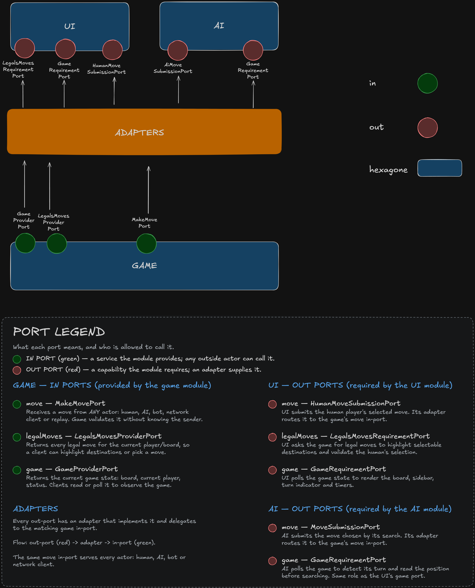

<p align="center">
  <h1 align="center">♟️ Checkers v3</h1>
  <p align="center">
    <strong>An AI-Powered Checkers Engine with Clean Hexagonal Architecture</strong>
  </p>
  <p align="center">
    Java 17 · JavaFX · PyTorch · Minimax · Neural Networks · Hexagonal Architecture
  </p>
</p>

---

## 📖 Overview

**Checkers v3** is a full-featured Checkers (Draughts) game built with a clean, modular hexagonal architecture. It features a **dual AI system** — a classical **Minimax search engine** with alpha-beta pruning in Java, and a **PyTorch-based neural network** in Python that learns from the Minimax engine through supervised online learning.

The project is designed as a showcase of **software engineering best practices**: clean architecture, design patterns, separation of concerns, and a hybrid AI approach that combines the strategic depth of classical game-tree search with the pattern recognition capabilities of deep learning.

---

## ✨ Features

### 🎮 Game Modes
| Mode | Status | Description |
|------|--------|-------------|
| **Human vs AI** | ✅ Running | Play against the Minimax AI engine |
| **Offline (2P)** | ✅ Running | Local two-player on the same machine |
| **AI vs AI** | ✅ Running | Watch two AI engines battle |
| **Online** | 🔧 Planned | Networked multiplayer |
| **Challenge** | 🔧 Planned | Puzzle/challenge mode |
| **CLI vs AI** | 🔧 Planned | Command-line interface mode |

### 🧠 Dual AI System
- **Minimax Engine (Java)** — Classical game-tree search with alpha-beta pruning, iterative deepening, killer move heuristic, history heuristic, PV table, and configurable evaluation function
- **Neural Network (Python/PyTorch)** — ResNet-style convolutional network with dual policy + value heads, trained via supervised learning from the Minimax teacher

### 🎯 Game Rules
- **Spanish/Tunisian Draughts** rules with mandatory maximum captures
- Flying kings (long-range diagonal movement)
- Multi-jump capture chains with recursive backtracking
- Automatic promotion to king on reaching the last row
- 40-move draw rule (no captures)

### 🖥️ User Interface
- JavaFX desktop GUI with interactive board
- Visual legal move highlighting (green borders)
- Selected piece highlighting (yellow border)
- Real-time sidebar with game status, turn indicator, captured piece count, and per-player timers
- Game mode selection screen
- Back-to-menu navigation

---

## 🏗️ Architecture

### Modular Hexagonal Architecture (Ports & Adapters)

The project follows a **Modular Hexagonal Architecture**. Rather than a single monolith, the system is split into independent, autonomous modules (`Game`, `AI`, `UI`), where **each module itself is a Hexagon**. 


    
Inside every module, you will find a strict separation of concerns:
- **Domain:** Pure business rules and entities
- **Application:** Use cases that orchestrate domain logic
- **In/Out Ports:** Interfaces defining what the module provides (In) and what it requires from the outside world (Out)
- **Adapters / Integration:** Implementations that wire the module to infrastructure or bridge communication between modules

### Why Modular Hexagonal?

| Benefit | How it's achieved |
|---------|-------------------|
| **Full Encapsulation** | Every module has its own domain and application layer, exposing only what is strictly necessary through ports. |
| **Swappable AI** | The AI communicates through `GameRequirementPort` (reads) and `MoveSubmissionPort` (writes) — swap Minimax for a neural net, MCTS, or a remote API without touching game logic. |
| **Swappable UI** | The UI communicates through its requirement ports — replace JavaFX with a web UI or CLI without changing the game. |
| **Module Independence** | The integration layer wires the modules together at the top level. The Game, AI, and UI modules never import each other directly. |

### 🛡️ The Agnostic Game Hexagon (Total Ignorance)

One of the most powerful aspects of this architecture is that the **Game Module has absolutely no idea who or what is playing**. It genuinely does not care. 

Whether a move is calculated by a PyTorch Neural Network, searched by a Java Minimax tree, clicked by a human on a JavaFX UI, or received over a network socket, the Game Hexagon sees it all the same way: a `Move` arriving at its `MakeMovePort`. 

The Game Hexagon's **only** responsibilities are pure domain logic:
1. Validating that a move is legally allowed according to Checkers rules.
2. Executing the move and resolving captures/promotions.
3. Managing game state (turn switching, win/draw conditions).

Because the Game module is entirely blind to the outside world, it is impossible for UI bugs, AI crashes, or network latency to corrupt the core game rules.

---

## 🎨 Design Patterns

### 1. Strategy Pattern
The capture rules engine uses the **Strategy pattern** via the `CaptureStrategy` interface. The current implementation is `SpanishTunisianCaptureStrategy`, but new rule variants (e.g., International Draughts, American Checkers) can be plugged in without modifying the `CheckersRules` class.

```java
public interface CaptureStrategy {
    List<Move> findCaptures(Board board, Player player);
}
```

### 2. Adapter Pattern
All module boundaries are crossed through **Adapter** classes that translate between ports:
- `AiMoveSubmissionAdapter` — adapts AI's `MoveSubmissionPort` → Game's `MakeMovePort`
- `AiGameRequirementAdapter` — adapts AI's `GameRequirementPort` → Game's `GameProviderPort`
- `HumanMoveAdapter` — adapts UI's `HumanMoveSubmissionPort` → Game's `MakeMovePort`
- `GameView_GameViewPort_Adapter` — adapts UI's `GameRequirementPort` → Game's `GameProviderPort`
- `LegalsMovesRequirementPort_LegalsMovesProviderPort_Adapter` — adapts UI's legal moves query → Game's legal moves provider

### 3. Dependency Injection (Manual IoC Container)
The `ApplicationContext` class is a **lightweight IoC container** supporting:
- **Singleton registration** — shared instances across the application
- **Factory registration** — prototype-scoped bean creation
- **Type-safe resolution** — `getBean(Class<T>)` returns the correct type

`GameConfig` acts as the **composition root**, wiring all dependencies together.

### 4. Observer Pattern (Polling Variant)
The `BoardView` and the `AiPlayer` use a **polling observer** — a JavaFX `Timeline` (UI) and a daemon thread (AI) — to detect game state changes every 20–100ms. This cleanly decouples both modules from the game loop: the UI never needs to be directly notified by the AI thread, and the AI is never told when to move — it watches the game through its own `GameRequirementPort`.

### 5. Immutable Value Objects
Domain objects like `Position`, `Move`, `Piece`, `Player`, and `PieceType` are **immutable value objects**:
- `Move` stores unmodifiable lists for `path` and `captured`
- `Position` is a simple `(row, column)` record
- `Piece` produces a new `Piece` via `promoted()` rather than mutating

### 6. Template Method (Search)
The `Search` class implements a structured search flow: `getBestMove()` → iterative deepening loop → `rootSearch()` → `negamax()`, with the evaluation, move ordering, and board simulation delegated to separate collaborators.

---

## 🧠 AI & Algorithms

### Minimax with Alpha-Beta Pruning (Java)

The Java AI engine implements a **Negamax** search (a simplified variant of Minimax) with **alpha-beta pruning** to eliminate branches that cannot influence the final decision.

#### Search Enhancements

| Technique | Purpose | Impact |
|-----------|---------|--------|
| **Iterative Deepening** | Searches depth 1, then 2, ..., up to max depth. Ensures a result is always available even under time pressure | Anytime algorithm — always has a valid move |
| **Alpha-Beta Pruning** | Prunes subtrees that are provably worse than already-found alternatives | Reduces search tree dramatically (typically √N of full Minimax) |
| **Time Control** | Checks elapsed time every 256 nodes and aborts if over budget | Guarantees responsive play within configurable time limits |
| **Killer Move Heuristic** | Remembers moves that caused beta cutoffs at each ply and by previous move | Improves move ordering → more pruning |
| **History Heuristic** | Tracks moves that historically cause cutoffs, weighted by `depth²` | Global move ordering improvement |
| **Principal Variation (PV) Table** | Stores the best line found so far and searches it first | Maximizes alpha-beta efficiency |
| **Single-Move Extension** | Extends search depth when only one legal move exists (forced moves) | Avoids horizon effects on forced sequences |
| **Move Ordering** | Sorts moves by: PV move (18M bonus) > captures > killer moves (100K bonus) > history score | Better ordering = exponentially more pruning |

#### Evaluation Function

The static board evaluation scores positions using:

| Feature | Weight | Description |
|---------|--------|-------------|
| Man value | 260 | Base value of a regular piece |
| King value | 200 | Base value of a king |
| Center bonus | +24 | Reward for controlling the 4 center squares |
| Extended center | +9 | Reward for the 12 extended-center squares |
| Edge penalty | -12 | Penalty for pieces stuck on the board edge |
| King center bonus | +4 | Kings are encouraged toward the center |
| King edge penalty | -2 | Kings are discouraged from edges |
| Progress weight | ×3 | Reward for advancing toward promotion |

All evaluation weights are **fully configurable** at runtime through setter methods.

### Neural Network (Python/PyTorch)

The Python AI module implements a **Residual Convolutional Neural Network** inspired by AlphaGo/AlphaZero's architecture:

#### Network Architecture

```
Input: [5 × 8 × 8] tensor
  ├── Channel 0: White men positions
  ├── Channel 1: White king positions
  ├── Channel 2: Black men positions
  ├── Channel 3: Black king positions
  └── Channel 4: Current player indicator (full plane)

→ Conv2d(5 → 64, 3×3) + BatchNorm + ReLU

→ 3 × ResidualBlock(64 channels)
    Each block: Conv → BN → ReLU → Conv → BN → Skip Connection → ReLU

→ Policy Head: Flatten → Linear(4096) → 4096 move logits
→ Value Head:  Flatten → Linear(128) → ReLU → Linear(1) → Tanh
```

#### Why This Architecture?

- **Residual blocks** prevent vanishing gradients and allow the network to learn identity mappings, enabling deeper networks
- **Dual heads** (policy + value) let the network simultaneously learn which moves are best AND how good the current position is
- **5-channel board encoding** gives the network complete information about piece types and whose turn it is
- **4096 move space** (64 × 64) encodes any from-to square pair, covering all possible moves

#### Online Supervised Learning

The neural network learns in real-time during gameplay:

1. **Java Minimax** calculates the best move (the "teacher move")
2. **Java sends** the board state + legal moves + teacher move to Python via JSON over stdin/stdout
3. **Python trains** on the teacher move using cross-entropy loss
4. **Python picks** its own best move using the current network weights
5. **Teacher agreement** is tracked to monitor learning progress
6. The model is **saved every 100 training steps** and on exit

#### Why Supervised Learning from Minimax?

- The Minimax engine provides a **strong, consistent teacher** — no need for millions of self-play games
- The neural network learns to **distill** the Minimax search into instant pattern recognition
- Over time, the network can play at near-Minimax strength with **O(1) inference time** instead of searching thousands of nodes
- The approach is **practical** — it works with small datasets and limited compute

### Java ↔ Python Bridge

The `PythonAI` class manages a **persistent Python subprocess** with bidirectional JSON communication over stdin/stdout:

```
Java (GameConfig) ──JSON──→ stdin ──→ Python (ai.py)
                  ←──JSON──← stdout ←──
                             stderr → logging/diagnostics
```

This design avoids the overhead of spawning a new process per move and keeps the model loaded in GPU/CPU memory.

---

## 📦 Project Structure

```
checkerv3/
├── pom.xml                              # Maven build (Java 17 + JavaFX 21 + JUnit 5)
├── README.md
│
├── src/main/java/
│   ├── main/
│   │   ├── App.java                     # Entry point
│   │   ├── GameApplication.java         # JavaFX Application lifecycle
│   │   └── config/
│   │       ├── ApplicationContext.java   # Lightweight IoC container
│   │       └── GameConfig.java           # Composition root — wires all modules
│   │
│   └── modules/
│       ├── game/                         # 🎯 GAME HEXAGON (Core Domain)
│       │   ├── domain/                   # Pure domain models
│       │   │   ├── Board.java            # 8×8 board with piece placement
│       │   │   ├── Game.java             # Game state, history, draw tracking
│       │   │   ├── Move.java             # Immutable move with path & captures
│       │   │   ├── Piece.java            # Immutable piece (player + type)
│       │   │   ├── PieceType.java        # MAN | KING
│       │   │   ├── Player.java           # WHITE | BLACK
│       │   │   ├── Position.java         # (row, column) value object
│       │   │   ├── GameMode.java         # AI | OFFLINE | ONLINE | ...
│       │   │   ├── GameState.java        # Game state snapshot
│       │   │   └── GameStatus.java       # IN_PROGRESS | WHITE_WON | BLACK_WON | DRAW
│       │   ├── application/use_cases/
│       │   │   ├── GameController.java   # Orchestrates moves and rules
│       │   │   └── rules/
│       │   │       ├── CheckersRules.java                    # Rule engine
│       │   │       └── utils/
│       │   │           ├── CaptureStrategy.java              # Strategy interface
│       │   │           └── SpanishTunisianCaptureStrategy.java # Concrete strategy
│       │   ├── in_ports/                 # Inbound ports (how others call the game)
│       │   │   ├── MakeMovePort.java
│       │   │   ├── GameProviderPort.java
│       │   │   └── LegalsMovesProviderPort.java
│       │   └── out_ports/                # (Reserved for future outbound events)
│       │
│       ├── ai/                           # 🧠 AI HEXAGON
│       │   ├── application/use_cases/
│       │   │   ├── AiPlayer.java         # Self-driving player (polls GameRequirementPort)
│       │   │   └── modules/
│       │   │       ├── Search.java       # Negamax with alpha-beta & iterative deepening
│       │   │       ├── Evaluation.java   # Configurable static evaluation
│       │   │       ├── MoveOrdering.java # PV + killers + history sorting
│       │   │       ├── BoardSimulator.java # Make/undo moves for search
│       │   │       └── BestMovePortAdapter.java # Entry point adapter
│       │   └── out_ports/
│       │       ├── GameRequirementPort.java  # How the AI reads the game state
│       │       └── MoveSubmissionPort.java # How the AI submits its chosen move
│       │
│       ├── ui/                           # 🖥️ UI HEXAGON
│       │   ├── application/use_cases/
│       │   │   ├── BoardView.java        # Interactive JavaFX board (760 lines)
│       │   │   ├── SideBar.java          # Status, timers, captured pieces
│       │   │   ├── MainWindow.java       # Window management & scene switching
│       │   │   └── GameModeSelectionView.java # Mode selection screen
│       │   └── out_ports/
│       │       ├── GameRequirementPort.java
│       │       ├── HumanMoveSubmissionPort.java
│       │       └── LegalsMovesRequirementPort.java
│       │
│       ├── integration/                  # 🔌 INTEGRATION ADAPTERS
│       │   └── infrastructure/adapters/
│       │       ├── AiMoveSubmissionAdapter.java
│       │       ├── AiGameRequirementAdapter.java
│       │       ├── HumanMoveAdapter.java
│       │       ├── GameView_GameViewPort_Adapter.java
│       │       └── LegalsMovesRequirementPort_LegalsMovesProviderPort_Adapter.java
│       │
│       └── PythonAI/                     # 🐍 PYTHON BRIDGE
│           └── PythonAI.java             # Subprocess manager with JSON I/O
│
├── CheckersRn/                           # 🤖 NEURAL NETWORK MODULE (Python)
│   ├── ai.py                             # Network definition + online training loop
│   ├── train.py                          # Offline batch training script
│   ├── test.py                           # Integration test for Python AI
│   ├── dataset.json                      # Training dataset
│   └── models/                           # Saved model weights (.pt files)
│
└── src/test/java/                        # 🧪 Unit tests (JUnit 5)
```

---

## 🚀 Getting Started

### Prerequisites

- **Java 17+** (JDK)
- **Maven 3.8+**
- **Python 3.9+** with PyTorch (`pip install torch`)

### Build & Run

```bash
# Clone the repository
git clone <repository-url>
cd checkerv3

# Build with Maven
mvn clean compile

# Run the application
mvn javafx:run
```

### Train the Neural Network (Optional)

```bash
cd CheckersRn

# Initial offline training from dataset
python train.py

# The model will be saved to models/ai_v001.pt
# Online learning happens automatically during gameplay
```

---

## 🔧 Maintainability & Extensibility

### Why This Codebase is Easy to Maintain

| Aspect | How |
|--------|-----|
| **Single Responsibility** | Each class has exactly one reason to change. `Search` only searches. `Evaluation` only evaluates. `BoardView` only renders. |
| **Dependency Inversion** | All modules depend on interfaces (ports), never on concrete implementations. Changing the AI doesn't require touching the UI or game logic. |
| **No Circular Dependencies** | The dependency graph is strictly: `Integration → [UI, AI, Game]`. Modules never reference each other directly. |
| **Immutable Domain** | `Move`, `Position`, `Piece` are immutable — no shared mutable state bugs, safe for multithreading. |
| **Configurable Evaluation** | All AI evaluation weights can be tuned via setters without recompiling — easy A/B testing and balancing. |
| **Modular AI** | The Minimax engine is composed of 4 small classes (`Search`, `Evaluation`, `MoveOrdering`, `BoardSimulator`), each independently testable. |
| **Clean Separation** | The Python neural network runs as a separate process — it can be updated, retrained, or replaced without recompiling Java. |

### How to Add a New Feature

<details>
<summary><strong>Add a new game rule variant (e.g., American Checkers)</strong></summary>

1. Create `AmericanCaptureStrategy implements CaptureStrategy`
2. Register it in `GameConfig.registerCommonBeans()`
3. Done — no other code changes needed

</details>

<details>
<summary><strong>Add a new AI algorithm (e.g., Monte Carlo Tree Search)</strong></summary>

1. Create a new class that computes a `Move` from a `Game`
2. Have it submit through `MoveSubmissionPort`
3. Wire it in `GameConfig.setupAIGame()`
4. Done — the game and UI are unchanged

</details>

<details>
<summary><strong>Add a new UI (e.g., Web interface)</strong></summary>

1. Implement `GameRequirementPort`, `LegalsMovesRequirementPort`, `HumanMoveSubmissionPort`
2. Connect through new adapters in the integration layer
3. Done — the game core and AI are completely unaware

</details>

<details>
<summary><strong>Add a new game mode</strong></summary>

1. Add a value to the `GameMode` enum
2. Add a `case` in `GameApplication.startGameWithMode()`
3. Create a `setupXxxGame()` method in `GameConfig`
4. Done

</details>

---

## 📊 Active Modules

| Module | Language | Status | Lines of Code |
|--------|----------|--------|---------------|
| **Game Domain** | Java | ✅ Active | ~500 |
| **Checkers Rules** | Java | ✅ Active | ~620 |
| **AI Search (Minimax)** | Java | ✅ Active | ~490 |
| **AI Evaluation** | Java | ✅ Active | ~323 |
| **AI Move Ordering** | Java | ✅ Active | ~208 |
| **AI Board Simulator** | Java | ✅ Active | ~117 |
| **UI (BoardView)** | Java | ✅ Active | ~760 |
| **UI (SideBar)** | Java | ✅ Active | ~340 |
| **UI (MainWindow)** | Java | ✅ Active | ~67 |
| **UI (Mode Selection)** | Java | ✅ Active | ~96 |
| **Integration Adapters** | Java | ✅ Active | ~100 |
| **Config / IoC** | Java | ✅ Active | ~350 |
| **Neural Network** | Python | ✅ Active | ~675 |
| **Offline Trainer** | Python | ✅ Active | ~131 |
| **Python Bridge** | Java | ✅ Active | ~62 |

**Total: ~4,800+ lines across 39 Java files and 4 Python files**

---

## 🛠️ Tech Stack

| Layer | Technology |
|-------|------------|
| **Language** | Java 17, Python 3 |
| **Build** | Maven 3 |
| **UI Framework** | JavaFX 21 |
| **AI Framework** | PyTorch |
| **Testing** | JUnit 5 |
| **Serialization** | Jackson (JSON) |
| **Architecture** | Hexagonal (Ports & Adapters) |

---

## 📄 License

This project is developed as an academic/personal project.

---

<p align="center">
  Built with ♟️ strategy, 🧠 intelligence, and 🏗️ clean architecture.
</p>
